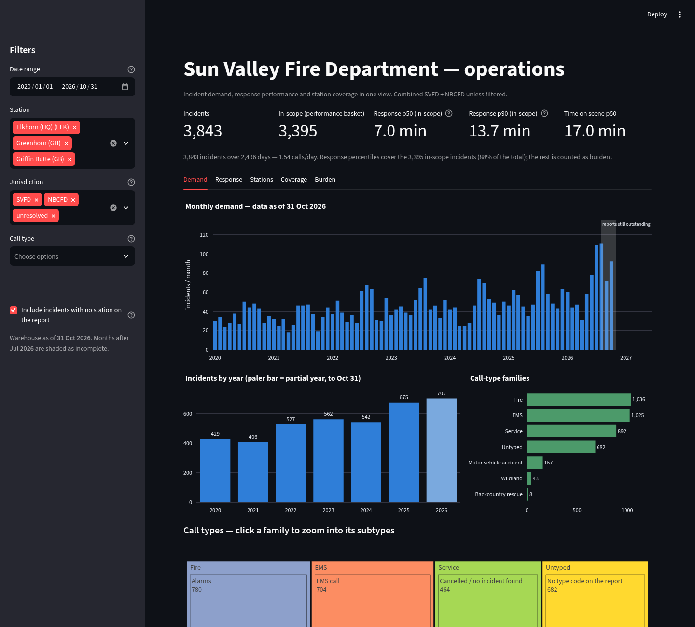
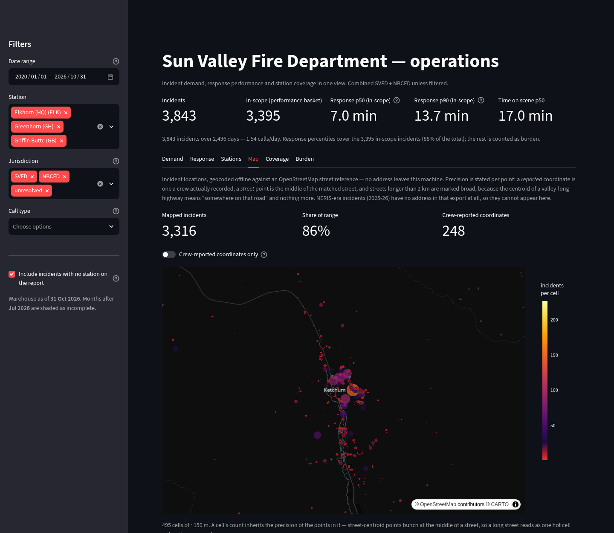
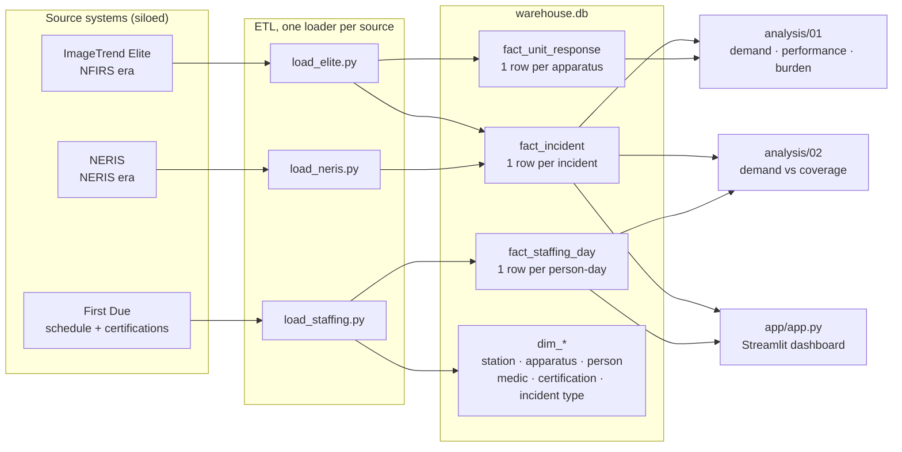

# SVFD Operations Warehouse

One warehouse over three systems that don't talk to each other, and a dashboard on top
of it, so the department can finally answer operational questions at any time scale.

A fire department's answers live in silos. Incident reporting lives in **ImageTrend
Elite**, which stops at NERIS with a second set of field names and a second set of
reporting habits. Staffing, qualifications and the shift calendar live in **First Due**.
Neither system can answer a question that spans both, and every identifier in both has
two to five spellings.

This project resolves the identity first, then measures: incident demand, response
performance, time on scene, and whether the crew on duty has anything to do with what
shows up.





## Motivation

The department's operational questions live in three systems that don't join. Incident
reporting is **ImageTrend Elite**, which hands off to NERIS under a second set of field
names and a second set of reporting habits; the shift calendar, roster and certifications
are in **First Due**. Neither system can answer a question that spans both, so those
questions get answered by hand, once, in a spreadsheet, and the answer is gone the moment
the period changes.

The vendor software also ships hundreds of canned reports, including response-time
fractiles and average time on scene. Recomputing those would be a tutorial. The value is in
what no single system can produce: incident volume read against the staffing calendar at an
arbitrary date range, station coverage against where the calls actually go, and the share of
workload that falls outside the response-performance measure, with the identity resolution
and the metric definitions written down, so any number can be traced back to the field it
came from.

It was built as the capstone for Boot.dev's Data Analyst path. Real department records
cannot leave the department, so the public copy ships a synthetic dataset that drives the
identical pipeline: clone this repository and you can run the build, both analyses and the
dashboard end to end with no real records in it.

## What it answers

| Question | Where the answer comes from |
|---|---|
| How many calls, at any date range, split by station or jurisdiction? | `fact_incident` |
| Did response performance change as demand grew? | `fact_incident`, in-scope basket only |
| How long is a crew committed per call, and per year? | `fact_unit_response`, unit-hours |
| When a station isn't staffed, what happens to its calls? | incident × `v_station_day` |
| How much of the schedule has a paramedic on duty? | `dim_person_medic` × `fact_staffing_day` |
| How much work falls outside the performance measure? | the burden basket |
| What kinds of calls are these, and what's inside each kind? | `etl/taxonomy.py` |
| Where do we actually run calls? | `dim_geo_street`, `fact_incident.geo_*` |

## Architecture



`etl/build.py` deletes the database and runs the three loaders in order, printing a row
count per source, so a source that silently contributes nothing is visible immediately.

## Quick Start

The pipeline is standard library only, so the ETL needs nothing installed but Python 3.10
or newer. The dashboard needs Streamlit, pandas and Plotly.

```bash
git clone https://github.com/jrbowlder/sunvalleyfiredata.git
cd sunvalleyfiredata

uv venv .venv
uv pip install -r requirements.txt
```

Then build and run the public copy, which is the synthetic dataset this repository ships:

```bash
python3 etl/synthetic.py        # write data/synthetic/raw, deterministic, ~1 s

export PYTHONHASHSEED=0 \
       SVFD_RAW=data/synthetic/raw \
       SVFD_CURATED=data/synthetic/curated \
       SVFD_CLEAN=data/synthetic/clean \
       SVFD_DB=data/synthetic/warehouse.db

python3 etl/build.py                        # rebuild the warehouse, ~2 s
python3 analysis/01_demand_performance.py   # demand, response percentiles, burden
python3 analysis/02_demand_vs_coverage.py   # demand against the staffing calendar
.venv/bin/streamlit run app/app.py          # dashboard on localhost:8501
```

`PYTHONHASHSEED=0` pins Python's per-process hash seed. Without it the loaders insert rows
in a different order on every run, so each table's content matches but the database file's
bytes do not.

The `SVFD_*` variables are the only difference between the public build and the private one.
Unset, every script reads and writes where it always did: `data/raw/` holds the real pulls
and `warehouse.db` sits at the repo root. Raw pulls are immutable; every file in
`data/clean/` and every `warehouse.db` is generated. The refresh steps for each source
(report IDs, endpoints, the quirks) are in [`etl/pull/SOURCES.md`](etl/pull/SOURCES.md).

## Usage

### The dashboard

`.venv/bin/streamlit run app/app.py` opens <http://localhost:8501>. The sidebar filters every
tab:

- **Date range** counts incidents by incident date; the staffing views read the shift
  calendar over the same range.
- **Station**, **Jurisdiction** (`SVFD`, `NBCFD`, unresolved) and **Call type** narrow the
  population. Jurisdiction is only resolvable from 2026, because the NFIRS era carries no
  reliable flag.
- **Include incidents with no station on the report** is on by default. 42% of records carry
  no primary station, so unticking it shows station-attributed work only, which is a subset
  and not the workload.

| Tab | What it shows |
|---|---|
| Demand | Monthly and annual incident counts, with the report-lag tail shaded |
| Response | In-scope p50/p90/p95 response times, turnout and travel, time on scene |
| Stations | Calls and in-scope p90 per station, on the same basket as the KPIs |
| Map | Incident points, each labelled with its geocoding precision |
| Coverage | Staffed station-days, paramedic coverage, and calls per crew size |
| Burden | In-scope work against the out-of-scope workload, in incidents and unit-hours |

Every view carries the warehouse's data-as-of date, and any month inside the reporting lag is
shaded rather than dropped, so an incomplete tail cannot be read as a decline.

### The analysis scripts

`analysis/01_demand_performance.py` and `analysis/02_demand_vs_coverage.py` print their own
tables with denominators, which is how every figure in `docs/FINDINGS_SYNTHETIC.md` can be
regenerated on demand. Each reads `warehouse.db` and honours `SVFD_DB`:

```bash
SVFD_DB=data/synthetic/warehouse.db python3 analysis/01_demand_performance.py
```

### The warehouse directly

Anything the scripts and dashboard don't cover is a query away. The three fact tables carry
three different grains, so check the grain before counting:

```bash
sqlite3 data/synthetic/warehouse.db \
  "select year, count(*) as incidents, round(avg(alarm_to_arrival_min), 1) as mean_minutes
     from fact_incident where is_actual = 1 group by year order by year;"
```

`is_actual = 1` filters out planning rows. `docs/SCHEMA.md` documents every table and column.

### The synthetic build

`etl/synthetic.py` writes a complete set of fake raw inputs in the same header formats the
loaders parse: invented personnel, street names and incident numbers, with a plausible shape
(demand growth 2020-2026, p50 around 7 min and p90 around 13 min, two stations, roughly 80%
paramedic coverage). Nothing but the public OSM street reference is shared with the real
build, which is why the geocoder still works.

The synthetic build deliberately differs from the private pull in three ways, so that a
public demo is usable: the NERIS era is **typed** (97% of rows carry a call-type code,
rather than 98% blank), NERIS-era **unit coverage is 55%** (against ~5% real), and every
person is invented. Every other quirk of the source systems (three numbering schemes,
repeated numbers across years, two timestamp families, mixed spellings) is reproduced on
purpose.

- [`docs/SCHEMA_SYNTHETIC.md`](docs/SCHEMA_SYNTHETIC.md): the schema of the shipped
  (synthetic) build, including the invented roster and the generator's parameters.
- [`docs/FINDINGS_SYNTHETIC.md`](docs/FINDINGS_SYNTHETIC.md): the results that build
  produces, reproducible from the scripts above.
- [`docs/SCHEMA.md`](docs/SCHEMA.md) and [`docs/FINDINGS.md`](docs/FINDINGS.md): the
  private dataset's write-ups, kept for the record and not part of the public copy.

## Repo layout

```
data/raw/        immutable source pulls (Elite CSVs, First Due JSON)
data/curated/    hand-checked dimensions (the medic list)
data/clean/      generated review files: identity conflicts, unresolved org
docs/            SCHEMA.md + FINDINGS.md (private build); SCHEMA_SYNTHETIC.md +
                 FINDINGS_SYNTHETIC.md (the shipped build)
etl/             one loader per source + build.py orchestrator
etl/load_geo.py  offline geocoding against the OSM street reference
etl/pull/        extraction scripts and SOURCES.md
analysis/        numbered scripts, one per analysis question
app/             Streamlit dashboard
warehouse.db     built artefact
```

## Data model

Three facts, three grains. Mixing them is the fastest way to a wrong number.

| Table | Grain | Key |
|---|---|---|
| `fact_incident` | one row per incident | `incident_uid` (surrogate) |
| `fact_unit_response` | one row per apparatus per incident | `unit_row_id` |
| `fact_staffing_day` | one row per person, day and assignment | `staffing_id` |

Every incident row carries `org_code` (`SVFD` / `NBCFD` / unresolved) with the reason it got
that value, so the two agencies the department runs stay separable; unit and staffing rows
inherit jurisdiction through their parent incident or station.

**Derived measures are computed at query time from stored timestamps, never stored as
typed values.** Response time, time on scene and unit-hours all come from the
timestamps plus a written definition, so a definition can change without a rebuild and an
auditor can follow a number back to the field it came from.

## Metric definitions

| Metric | Definition | Grain |
|---|---|---|
| `demand` | count of in-scope incidents | incident |
| `response_time` | alarm → first unit arrival | incident |
| `turnout_time` | dispatch → en route | unit |
| `travel_time` | en route → arrival | unit |
| `time_on_scene` | arrived → cleared | unit |
| `unit_hours` | cleared − dispatch, summed | unit |
| `coverage_days` | days with at least one medic-qualified person on a station assignment | staffing |

Call types are a two-level taxonomy driven by the NFIRS type code: **Fire** (structure,
vehicle, alarms, HazMat, other), **Wildland**, **EMS**, **Motor vehicle accident** (with
injury, no injury, vehicle extrication, cleanup), **Backcountry rescue** and **Service**,
each with subtypes. Mutual aid is a flag, not a
type: a mutual-aid structure fire counts as a structure fire.

Two baskets, not one filter. **Performance** uses in-scope incidents only: no mutual aid
given, not a wildland deployment, arrival within 25 minutes. Everything excluded is
reported separately as **burden** (unit-hours consumed), following the NFPA 1710/1720
convention that out-of-scope work is workload, not response performance. Baskets travel
together: a response-time percentile is never quoted without the share of work it covers.

## What the data said

Full write-up with denominators in [`docs/FINDINGS.md`](docs/FINDINGS.md). Headlines,
2020-2025:

- **Demand is up 57%** (429 → 675 incidents) and 2026 is running 25% above 2025 per day.
- **Response performance did not degrade.** p90 sits between 13.0 and 14.7 minutes in
  every year of the series, and p50 at 6.7-7.3. The department absorbed the growth.
- **Time on scene is stable** at a 14-19 minute median.
- **Staffing is unrelated to demand:** 2.09 calls per station-day with two crew on duty,
  2.10 with three. The rotation sets the staffing; the pager sets the workload.
- **Greenhorn went from staffed 46% of days in 2025 to 93% in 2026**, and its share of
  calls grew with it.

The number that would have been wrong: an early version reported 113 incidents with no
unit rows. That was duplicate incident numbers in the export, not missing data. Every
distinct incident has unit rows.

## Decisions that make the numbers survive review

1. **Identity before measurement.** Station names (`Elkhorn Station` vs
   `Elkhorn Station - HQ` vs `Station 2`), apparatus spellings (`E60` vs `ENG60`) and
   personnel names are reconciled in one place, and the review lists are committed under
   `data/clean/` so any mapping can be challenged.
2. **A business key is not a primary key until proven unique across history.** Incident
   numbers repeat across years (the same `24-454` is a 2024 record and a 2026 record), so
   the fact table uses a surrogate id. A `TEXT PRIMARY KEY` plus `INSERT OR REPLACE` had
   silently replaced 13 real incidents while every row count still looked plausible.
3. **Two timestamp families, coalesced with provenance.** NERIS carries dispatch-side and
   incident-side timestamps and crews populate one or the other; 70 of 240 rows missing a
   dispatch alarm time were recoverable from the incident side. Each value records which
   side supplied it.
4. **A curated dimension with a stated basis.** Paramedic status cannot be derived from
   either First Due source (groups carry only current membership; certifications are
   incomplete for four of nine medics), so `dim_person_medic` carries `certification`,
   `roster_confirmed` or `estimated` per person, and coverage is published as a band when
   the two ends differ.
5. **Completeness lag is modelled, not ignored.** Reports are written after the fact, so
   the newest months are always under-counted. Every trend chart carries a data-as-of date
   and shades the incomplete tail; a unit-grain year with thin apparatus records is
   omitted and captioned rather than plotted as zero.

## Limitations

- **Reporting lag.** The last ~3 months are incomplete. Never read the tail as decline.
- **Unit-level data ends with the NFIRS era.** Only 32 of 693 incidents in 2026 have
  apparatus rows, so time-on-scene and unit-hours are published through 2025 only.
- **Station attribution** is the station on the report, not necessarily the responding
  one, and 42% of records carry no station at all.
- **Jurisdiction is only resolvable from 2026.** The NFIRS era has no reliable
  SVFD/NBCFD signal, so jurisdiction comparisons start there and say so.
- **Staffing calendar starts 2024-12-31**, so coverage questions cannot extend backwards.
- **Location is street-level, not address-level.** 248 incidents carry a coordinate a
  crew recorded; the rest are placed at the centroid of their street, and streets longer
  than 2 km are flagged broad. The NERIS era (2025-26) has no address in its export and
  cannot be mapped at all.
- The paramedic p90 difference in 2026 rests on 16 calls. It is a hypothesis, labelled as
  one.

## Data and privacy

No patient, name-level or address-level record is exported, and none of it is required for
any metric here: everything is incident, apparatus and station-shift grain, aggregated at
report time. `data/raw/` is the department's source material and is not for
redistribution, with one exception: `data/raw/osm_streets.csv` and `data/raw/osm_places.csv`
are public OpenStreetMap extracts, committed so the repository can geocode without calling a
hosted service. The dashboard screenshot is real aggregates from the private dataset.

For a public copy of this repo, `etl/synthetic.py` writes the same schema with plausible
distributions (invented people, addresses and incident numbers), so a reviewer can clone
and run the whole pipeline with **zero real records**. The public copy ships that build
and the two `*_SYNTHETIC.md` documents; `data/clean/`, the real `warehouse.db` and every
other file in `data/raw/` stay out of the repository.

## Roadmap

- [x] Warehouse with verified rebuild, referential checks and zero duplicate keys
- [x] Two analysis scripts, every figure reproducible
- [x] Streamlit dashboard: date range, station, jurisdiction and call-type filters,
      six views, with a drill-down call-type treemap
- [x] Call-type taxonomy rebuilt from NFIRS codes after the keyword classifier was found
      to be misfiling cooking fires as rescues
- [x] Synthetic data generator, verified end to end (build, analyses and dashboard all
      run against it)
- [ ] Validation against ImageTrend's own canned reports (fractile response times,
      average time on scene) to prove definition parity
- [ ] One Tableau Public viz for the portfolio

## Contributing

Issues and pull requests are welcome. The one hard rule is that no real department record
enters the repository. `data/raw/` is ignored for exactly that reason (the two OpenStreetMap
extracts are the only committed files there), so build against the synthetic dataset.

### Clone the repo

```bash
git clone https://github.com/jrbowlder/sunvalleyfiredata.git
cd sunvalleyfiredata

uv venv .venv
uv pip install -r requirements.txt
```

### Build and run the synthetic copy

```bash
python3 etl/synthetic.py
```

Then apply the `SVFD_*` exports from [Quick Start](#quick-start) and run:

```bash
python3 etl/build.py
python3 analysis/01_demand_performance.py
python3 analysis/02_demand_vs_coverage.py
.venv/bin/streamlit run app/app.py
```

### Check your change

There is no test suite yet; the pipeline is its own check, and these are the things worth
looking at:

- `etl/build.py` prints a row count per loader, so a source that silently contributes
  nothing is visible immediately.
- Both analysis scripts should still reproduce `docs/FINDINGS_SYNTHETIC.md`. A number that
  moves is either a real change or a broken definition, and the write-up is how you tell.
- The dashboard should render all six tabs without an exception, against the synthetic
  warehouse.

### Submit a pull request

Fork the repository, make the change on a branch, and open a pull request against `main`.
If a change touches a table, a column or a metric definition, update
`docs/SCHEMA_SYNTHETIC.md` and `docs/FINDINGS_SYNTHETIC.md` in the same pull request. The
docs are the specification, and letting them drift is the failure mode this project exists
to avoid.
